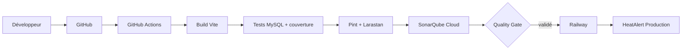

# DevOps — HeatAlert

## Architecture



## Prérequis locaux

- PHP 8.2 et Composer 2 ;
- Node.js 22 et npm ;
- MySQL pour l’application locale ;
- une copie locale de `.env` créée depuis `.env.example`.

```powershell
composer install
npm ci
npm run build
php artisan test
vendor/bin/pint --test
vendor/bin/phpstan analyse
```

Larastan démarre au niveau 1 sur l’ensemble du code applicatif, sans baseline ni exclusions du
code métier. L’audit au niveau 3 met en évidence de la dette de typage Eloquent historique
(propriétés de modèles, relations génériques et dates dynamiques). Ce niveau initial reste un
contrôle stable et bloquant ; le niveau devra être augmenté par petites corrections typées, sans
masquer ces erreurs.

La couverture est produite par le CI grâce à PCOV. Sur une machine locale, il faut installer
PCOV ou Xdebug pour générer `coverage.xml` :

```powershell
php -d pcov.enabled=1 artisan test --coverage-clover=coverage.xml
```

## Workflow Git

1. Créer une branche à partir de `main`.
2. Ouvrir une pull request vers `main`.
3. Attendre le workflow **HeatAlert CI** et, une fois configuré, le job **SonarQube Cloud Quality Gate**.
4. Fusionner uniquement lorsque tous les checks requis sont verts.

Titre recommandé pour la pull request DevOps :

```text
DevOps: add CI, quality gates and Railway deployment
```

Ne pas modifier l’historique publié, ne pas faire de force-push et ne jamais versionner `.env`.

## GitHub Actions

Le workflow utilise PHP 8.2, Node 22 et un service MySQL 8 éphémère nommé `heatalert_test`.
Les identifiants MySQL déclarés dans le workflow sont réservés au conteneur CI et ne sont pas
des identifiants de production. Les variables de test empêchent l’envoi de mails, l’exécution de
jobs asynchrones et les dépendances de session/cache externes.

Les appels HTTP et notifications des tests sont simulés avec les fakes Laravel existants ; aucune
clé Open-Meteo, Nominatim, Geoapify, Gemini, Groq ou SMTP n’est nécessaire au CI.

La vérification Sonar est volontairement ignorée tant que son projet n’est pas configuré. Dès que
les trois paramètres ci-dessous existent, le scanner attend le Quality Gate et fait échouer le
workflow si celui-ci est rouge.

### Secrets et variables GitHub à créer

Créer dans **Settings → Secrets and variables → Actions** :

| Type | Nom | Usage |
| --- | --- | --- |
| Secret | `SONAR_TOKEN` | Token d’analyse SonarQube Cloud |
| Variable | `SONAR_PROJECT_KEY` | Clé réelle du projet SonarQube Cloud |
| Variable | `SONAR_ORGANIZATION` | Organisation SonarQube Cloud |

Ne pas créer de fausse valeur et ne pas écrire ces valeurs dans un fichier du dépôt.

Dans GitHub, protéger `main` en exigeant les checks **Build, tests and static analysis** et
**SonarQube Cloud Quality Gate** après le premier passage Sonar. SonarQube Cloud publie aussi son
statut de Quality Gate sur les pull requests ; sélectionner ce check comme requis si disponible.

## SonarQube Cloud

1. Créer une organisation et importer le dépôt GitHub dans SonarQube Cloud.
2. Créer le token d’analyse du projet et l’ajouter comme secret GitHub `SONAR_TOKEN`.
3. Ajouter la clé et l’organisation dans les variables GitHub indiquées ci-dessus.
4. Fusionner ou pousser une modification : le job Sonar récupère `coverage.xml` produit par le job de vérification.
5. Dans SonarQube Cloud, choisir le Quality Gate adapté au projet. Le Quality Gate par défaut
   est une base raisonnable ; ne pas assouplir ses règles uniquement pour rendre un échec vert.

`sonar-project.properties` ne contient ni token ni clé de projet. Il définit les sources,
les tests, la couverture PHPUnit et les exclusions des dépendances/builds générés.

## Railway

La stratégie retenue est **Railway GitHub Integration avec Wait for CI**. Elle est plus simple
et plus robuste que d’ajouter un token Railway à GitHub Actions : Railway attend les checks du
commit `main`, notamment le Quality Gate Sonar, avant de déployer.

1. Créer un projet Railway et ajouter un service **MySQL**.
2. Connecter le service web au dépôt GitHub, sur la branche `main`.
3. Dans les paramètres du service, activer **Wait for CI**.
4. Laisser Railway détecter Laravel (PHP-FPM + Caddy) plutôt que d’imposer `php artisan serve`.
5. Configurer le build des assets avec `npm ci && npm run build` si Railway ne le détecte pas
   automatiquement pour ce projet.
6. Le fichier `railway.toml` exécute uniquement `php artisan migrate --force` avant déploiement,
   configure `/up` comme health check et ne lance ni seed ni commande destructive.
7. Générer le domaine Railway puis renseigner sa valeur HTTPS comme `APP_URL`.

### Variables Railway à renseigner manuellement

| Groupe | Variables |
| --- | --- |
| Laravel | `APP_NAME`, `APP_ENV=production`, `APP_KEY`, `APP_DEBUG=false`, `APP_URL` |
| Base MySQL | `DB_CONNECTION=mysql`, `DB_HOST`, `DB_PORT`, `DB_DATABASE`, `DB_USERNAME`, `DB_PASSWORD` |
| Sessions/cache/queue | `CACHE_STORE`, `SESSION_DRIVER`, `QUEUE_CONNECTION` |
| Journalisation | `LOG_CHANNEL=stderr`, `LOG_STDERR_FORMATTER` |
| E-mail | `MAIL_MAILER`, `MAIL_HOST`, `MAIL_PORT`, `MAIL_USERNAME`, `MAIL_PASSWORD`, `MAIL_FROM_ADDRESS`, `MAIL_FROM_NAME`, `MAIL_SCHEME` |
| IA et géocodage | `GEMINI_API_KEY`, `GEMINI_MODEL`, `GROQ_API_KEY`, `GROQ_MODEL`, `GEOAPIFY_API_KEY` |

Créer une clé de production sur une machine sûre avec :

```powershell
php artisan key:generate --show
```

Copier uniquement cette valeur dans les variables Railway. Ne jamais réutiliser la clé locale.
Les variables MySQL doivent référencer le service MySQL Railway, jamais la base locale.

### Migrations, seeders et rollback

La seule migration automatique de production est :

```text
php artisan migrate --force
```

Ne jamais utiliser `migrate:fresh`, `migrate:reset`, `db:wipe` ou `HeatAlertDemoSeeder` en
production. Pour revenir en arrière, redeployer le dernier commit validé depuis Railway/GitHub,
puis n’exécuter une migration inverse qu’après une sauvegarde vérifiée et une décision explicite.

### Storage et fichiers envoyés

Les photos de profil utilisent actuellement le disque Laravel `public`, donc
`storage/app/public`. Le système de fichiers Railway est éphémère : un redéploiement peut faire
disparaître ces fichiers. Avant une mise en production durable, choisir explicitement soit un
volume Railway adapté, soit un stockage objet compatible S3. Aucun stockage payant ou migration de
fichiers n’est créé automatiquement par cette préparation.

## Dépannage

- **Sonar ignoré** : créer `SONAR_TOKEN`, `SONAR_PROJECT_KEY` et `SONAR_ORGANIZATION` dans GitHub.
- **MySQL CI indisponible** : vérifier l’état de santé du service MySQL dans les logs GitHub Actions.
- **Couverture indisponible en local** : installer PCOV ou Xdebug ; le CI installe PCOV.
- **Pint/Larastan rouge** : corriger le code signalé, sans ajouter une baseline globale pour masquer la dette.
- **Déploiement Railway bloqué** : vérifier que Wait for CI est activé, que la branche est `main`,
  que le health check `/up` répond et que les variables Railway sont définies.
